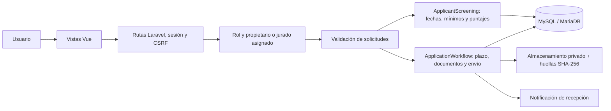

# Convocatoria docente UNHEVAL

Aplicación en Laravel 13, PHP 8.3 o superior, Vue 3, Inertia 3 y MySQL/MariaDB. Esta versión permite demostrar el formulario estructurado, los cálculos preliminares y la revisión documental. Las reglas de ejemplo no constituyen bases oficiales aprobadas.

## Instalación para la presentación

**Requisitos:** PHP 8.3+ con PDO MySQL, Fileinfo y Mbstring; Composer; MySQL iniciado en XAMPP. Un XAMPP con PHP 8.2 no puede ejecutar esta versión de Laravel.

1. Copia o extrae el proyecto. En la terminal entra a su carpeta.
2. Crea en MySQL la base `convocatoria_unheval` con cotejamiento `utf8mb4_unicode_ci`.
3. Ejecuta:

```powershell
composer install --no-dev --prefer-dist
Copy-Item .env.example .env
php artisan key:generate
php artisan migrate --seed
php artisan serve --host=127.0.0.1 --port=8000
```

Abre `http://localhost:8000`. Si la base tiene usuario, contraseña o nombre diferentes, ajusta `DB_USERNAME`, `DB_PASSWORD` y `DB_DATABASE` en `.env` **antes de migrar**. La copia de `.env` y la generación de clave se realizan solo en la instalación nueva.

El ZIP de presentación incluye las vistas ya compiladas en `public/build`; no necesita Node.js para ejecutarse. Si descargas una copia sin esa carpeta, instala Node.js y ejecuta `npm ci` y `npm run build`. Para desarrollo se recomienda `composer install` con las dependencias de pruebas.

La plantilla `.env.example` activa `APP_ENV=local`, `RECRUITMENT_DEMO=true`, MySQL y correo en archivo de registro. Con esta configuración `migrate --seed` instala solo seis cuentas, un concurso y las dos plazas del PDF; no inventa postulantes ni resultados. Fuera del entorno local no se instalan los datos de demostración.

Con Apache, apunta el sitio al directorio `public`. En el XAMPP predeterminado también puedes usar `/covocatoria_unheval/public/`; los enlaces conservan ese prefijo. El `.htaccess` de la raíz restringe el acceso al código de la aplicación.

## Descargar desde GitHub

El repositorio contiene el código y los archivos de dependencias; la base de datos, `.env`, los documentos privados, `vendor`, `node_modules` y `public/build` se generan o configuran en cada equipo. El ZIP de presentación es una entrega distinta que sí incluye las vistas compiladas.

En otra PC, con Git, PHP 8.3+, Composer, Node.js compatible con Vite 8 y MySQL disponibles:

```powershell
git clone https://github.com/josesaturninoroblesfabian-creator/convocatoria_unheval.git
cd convocatoria_unheval
composer install
Copy-Item .env.example .env
php artisan key:generate
npm ci
npm run build
```

Crea la base `convocatoria_unheval` y ajusta la conexión en `.env`. Después ejecuta `php artisan migrate --seed` y `php artisan serve`. Estos pasos son para una copia nueva; no sobrescribas el `.env` ni regeneres la clave de una instalación existente.

## Continuidad del proyecto en otro equipo

Estado del proyecto al 2 de noviembre de 2026: demostración local en Laravel 13, Vue 3, Inertia 3 y MySQL, con seis cuentas de prueba y dos plazas de referencia. Se eligió el formulario estructurado con documentos por mérito. Las fechas se calculan sin duplicar periodos, los mínimos bloquean el avance y el puntaje preliminar ayuda a ordenar la revisión; el jurado conserva la verificación documental y la calificación oficial. Se conservaron la foto institucional y el encabezado oscuro, con azules en el portal y los paneles. La última verificación funcional completó 54 pruebas y 302 comprobaciones tanto con SQLite como con MySQL.

La prioridad es una demostración entendible para los ingenieros de la universidad. Los requisitos y puntajes de ejemplo deben validarse con las bases aprobadas antes de habilitar convocatorias oficiales. El catálogo completo y las integraciones institucionales siguen pendientes; consulta «Fuentes y alcance» y la explicación de responsabilidades más abajo.

GitHub conserva el código y este resumen; no transporta automáticamente el historial del chat. Para abrir el mismo chat desde otra PC se puede usar la conexión remota de la aplicación, cuando esté disponible: en el equipo actual, Configuración → Conexiones → Controlar este PC; en el otro, misma cuenta y espacio de trabajo → Conexiones → Controlar otros dispositivos. El equipo de origen debe estar encendido, conectado y con la aplicación abierta. La disponibilidad depende de la versión y de la cuenta. Consulta la [documentación oficial de conexiones](https://learn.chatgpt.com/docs/remote-connections).

Para trasladar también la ejecución a otra máquina conectada, primero guarda allí un proyecto del mismo repositorio y usa la opción de transferencia del chat («Hand off»). Clonar el repositorio por sí solo no cambia la ubicación en la que se ejecuta el chat. Si se inicia un chat nuevo sobre una copia independiente, pide que lea este README, `AGENTS.md`, los servicios y las pruebas antes de continuar: eso recupera las decisiones documentadas, aunque no el historial íntegro de la conversación.

## Accesos de prueba

La contraseña de cada cuenta es su DNI de prueba. El acceso sigue validando la contraseña en el servidor.

| Rol | Correo | Contraseña / DNI |
| --- | --- | --- |
| Administrador | admin@demo.test | 90000001 |
| Gestor | gestor@demo.test | 90000002 |
| Jurado 1 | jurado@demo.test | 90000003 |
| Jurado 2 | jurado2@demo.test | 90000004 |
| Jurado 3 | jurado3@demo.test | 90000005 |
| Postulante | postulante@demo.test | 90000006 |

La pantalla de acceso ofrece botones para rellenar los perfiles principales. `php artisan unheval:demo` también actualiza las contraseñas de estas seis cuentas al DNI. No debilita la política de contraseñas de las cuentas nuevas.

Para volver a empezar **solo la demo**, desde el entorno local:

```powershell
php artisan unheval:demo --reset
```

Este comando elimina los tres códigos de ejemplo que se usaron durante la construcción y sus expedientes de cuentas de prueba. Se niega a borrarlos si encuentra postulantes ajenos a esas cuentas. No elimina otras convocatorias ni recrea toda la base. Repetir el comando sin `--reset` conserva los expedientes y las fechas existentes.

## Método elegido y recorrido del postulante

Se usa el **método 1: formulario estructurado con sustentos por cada declaración**. El método 2, cargar un formato libre, no permite calcular fechas o puntajes con fiabilidad sin transcribirlo u operar con OCR. Un PDF adjunto no se considera auténtico ni verificado automáticamente.

1. El visitante consulta una tabla de convocatorias, documentos de referencia y periodo de inscripción. Puede revisar una convocatoria futura; el servidor impide postular antes de la apertura.
2. Abre una convocatoria y consulta sus plazas, perfil profesional y carga académica.
3. Inicia un borrador durante el periodo de inscripción.
4. Registra su título, grado, fecha de bachiller, periodos de servicio, cursos y preguntas específicas configuradas para esa plaza.
5. Guarda y calcula. Si falta un mínimo, ve el motivo y no puede avanzar a la carga documental o al envío; puede corregir el borrador. Esta comprobación no lo declara oficialmente No apto.
6. Si cumple lo declarado, carga el título, el grado, el bachiller cuando corresponde y un PDF por cada experiencia y capacitación. También adjunta los demás requisitos del perfil.
7. Revisa y confirma el envío. El servidor vuelve a comprobar fechas, mínimos, declaración y documentos obligatorios; congela las respuestas y el resumen calculado y emite un cargo imprimible.

La identidad, las respuestas, las reglas, las huellas de los archivos y el resultado preliminar forman parte del expediente conservado. Después del envío no se puede editar.

## Guion práctico para explicar el sistema

1. Inicia sesión como postulante, abre Turismo y Hotelería e inicia el expediente.
2. En el formulario pulsa **Ejemplo de 2 años**. Son datos ficticios; guarda y calcula. Verás el incumplimiento del mínimo de 60 meses y no podrás pasar a documentos.
3. Pulsa **Ejemplo de 6 años**, acepta la declaración y comprueba de nuevo. El grado de maestro suma 6 puntos, seis años completos suman 6 y el curso de 80 horas suma 2: **14 puntos declarados** con la configuración inicial.
4. Adjunta los PDF solicitados. Para la demostración puedes reutilizar `database/fixtures/sustento-demo.pdf`, que indica expresamente que no acredita ningún mérito real.
5. Envía el expediente y abre el cargo. Guarda el PDF desde la impresión del navegador.
6. Entra como gestor, abre el concurso y pulsa **Cerrar inscripción de prueba**. Este control local cambia el cierre del proceso de ejemplo y su etapa; no altera el reloj del equipo ni funciona con procesos oficiales.
7. Entra como jurado. En **Expedientes** encontrarás la cola ordenada por mayor puntaje declarado o por recepción. El orden ayuda a priorizar; no adjudica plazas ni permite omitir decisiones sobre otros expedientes recibidos.
8. Abre el expediente: compara el resumen de fechas y méritos con los PDF, registra Cumple o No cumple y motiva la decisión.
9. Si queda Apto, cada jurado puede copiar los puntos calculados a su borrador, corregirlos según los sustentos y calificar la clase y la entrevista. Después cierra su calificación por los rubros del concurso. Las notas de los otros jurados no son visibles en su formulario.
10. Cuando los tres terminen, el gestor finaliza el concurso y publica el promedio de prueba. Un empate queda señalado para revisión de la comisión.

Para enseñar la configuración administrativa, crea un concurso en borrador, añade una plaza y abre **Configurar formulario**. Allí puedes variar el grado mínimo, los meses, los topes o añadir una selección obligatoria con respuesta exigida y documento de sustento. Estas opciones se bloquean al publicar.

## Cómo se calcula

- **Experiencia:** fechas calendario inclusivas. Cada fin se transforma internamente al día siguiente, se recorta a la fecha de corte y, si se configuró, al bachiller; se unen intervalos superpuestos o contiguos y se suman los días sin duplicarlos. Puede computarse experiencia profesional, docente o ambas.
- **Mínimo:** los meses exigidos se convierten a días calendario tomando como referencia el día siguiente al corte y restando los meses con control de fin de mes. No se usa la aproximación de 30 días por mes para decidir si cumple.
- **Puntos de experiencia:** años completos equivalentes a esos días al mismo corte, multiplicados por el valor configurado y limitados por el tope.
- **Formación:** puntos del grado seleccionado; maestro y doctor no se suman entre sí.
- **Capacitación:** horas de cursos declarados, puntos por bloques completos de horas y tope configurable.
- **Preguntas adicionales:** texto, selección, número o fecha; pueden ser obligatorias y exigir una respuesta determinada y un sustento. Por ejemplo, un idioma se configura únicamente si las bases de esa plaza lo requieren.
- **Corte:** el día actual del servidor o la fecha de cierre si es anterior. No se admite experiencia futura. Tras el envío el cálculo queda conservado y no crece con el paso del tiempo.

Los valores iniciales de puntaje son ejemplos para probar el motor. El jurado debe verificar que los documentos acreditan lo declarado. No se ha implementado reconocimiento automático de diplomas, consulta SUNEDU ni autenticación de certificados.

## Arquitectura para el equipo de ingeniería



| Ubicación | Responsabilidad |
| --- | --- |
| `app/Services/ApplicantScreening.php` | Cálculo, filtros y lista de sustentos derivados del formulario |
| `app/Services/ApplicationWorkflow.php` | Control de inscripción y envío con transacciones |
| `app/Http/Requests/ConfigureScreeningRequest.php` | Forma y límites de las reglas que configura el gestor |
| `app/Http/Requests/SaveApplicationFormRequest.php` | Validación de las respuestas del postulante |
| `app/Http/Controllers/ApplicationController.php` | Borrador, formulario, archivos privados y cargo |
| `app/Http/Controllers/ManagementController.php` | Convocatorias, usuarios, configuración y cola de revisión |
| `app/Http/Controllers/ReviewController.php` | Aptitud y calificaciones del jurado |
| `resources/js/Components/StructuredApplicationForm.vue` | Campos de formación, experiencia y capacitación |
| `resources/js/Components/ScreeningEditor.vue` | Configuración de las preguntas y reglas por plaza |
| `resources/js/Components/ScreeningSummary.vue` | Resumen de mínimos y puntajes declarados |
| `resources/js/Components/PdfViewer.vue` | Visor PDF.js local con paginación |
| `resources/js/Pages` y `Layouts` | Pantallas y navegación compartida |
| `database/migrations` | Esquema reproducible de la base |
| `tests/Feature` | Pruebas de permisos, fechas, cálculos y recorridos |

Las entidades principales son usuarios, convocatorias, plazas, postulaciones, documentos, asignaciones de jurados, evaluaciones y actividad. `vacancies.screening_rules` conserva las reglas por plaza; `applications.form_data` las respuestas; `screening_snapshot` el cálculo conservado al enviar y `declared_score` el puntaje preliminar para ordenar la cola. Las respuestas no pueden modificar sus propios puntos ni las reglas.

El estado de convocatoria es Borrador → Publicada → En evaluación → Finalizada → Archivada. El expediente pasa de Borrador a Recibida y luego a Apto/No apto; al cerrar todos los jurados queda Evaluada. El motor automático previo no reemplaza esa decisión documental.

## Fuentes y alcance

Se conservan los perfiles y cursos del PDF de nombramiento 2026-IV proporcionado: Educación, AIRHSP `000078`, CAP `318`; Turismo, AIRHSP `000206`, CAP `200`. Los ceros iniciales se guardan como texto. Los documentos en `public/documents` son referencias históricas; no se cambian sus fechas para aparentar bases nuevas.

La [web institucional](https://unheval.edu.pe/portal/la_universidad) indica **14 facultades y 27 escuelas profesionales**. La prueba contiene solo las dos facultades del PDF y no inventa un catálogo completo. La relación definitiva con los catálogos institucionales sigue pendiente.

La versión inicial de Gemini mezclaba reglas de contratación con nombramiento. Los puntajes de prueba aquí configurados no se anuncian como normativa aprobada. La publicación de procesos oficiales continúa bloqueada hasta completar y validar los anexos, mínimos por categoría, bonificaciones, desempates, recursos y autorizaciones correspondientes.

Faltan la integración SSO/escalafón, la validación externa de documentos, catálogos maestros, abstenciones y reemplazos de jurados, recursos impugnatorios, actas con firma digital y validación integral de la normativa. El portal y el motor actuales son una demostración funcional del recorrido digital.

## Operación y verificación

Los documentos privados se sirven con autorización; no se publican mediante enlaces abiertos a `storage`. La recepción y las calificaciones se guardan con transacciones. La huella SHA-256 es una comprobación de integridad, no firma digital. El correo local se escribe en `storage/logs/laravel.log`; no se envían mensajes reales a la universidad.

Para procesar la cola de recepción en otra terminal: `php artisan queue:work --tries=3`.

En el equipo de desarrollo:

```powershell
composer install
php artisan test --compact
php vendor/bin/pint --format agent
npx prettier --check resources/js resources/css vite.config.js package.json
npm run build
```

Las pruebas predeterminadas usan SQLite en memoria. También se verifica una base MySQL independiente llamada `convocatoria_unheval_testing_codex`, sin tocar la base de trabajo. No utilices `migrate:fresh` para preparar una presentación sobre una instalación con datos que quieras conservar.
